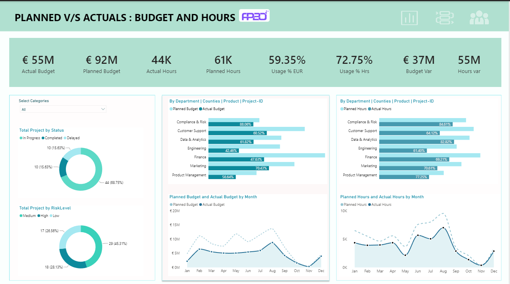

# Project & Task Performance Analytics Dashboard

A professional **Power BI dashboard** for monitoring project delivery, budget utilization, planned vs actual hours, task performance, employee efficiency, and resource costs.

The dashboard is designed for project managers, department heads, PMO teams, and business stakeholders who need a clear view of project health and workforce performance.

## Dashboard Preview

### 1. Planned vs Actuals: Budget and Hours



This page provides a high-level view of:

- Actual vs planned budget
- Actual vs planned hours
- Budget variance
- Hours variance
- Budget and hours utilization
- Project status distribution`
- Project risk-level distribution
- Department-wise planned vs actual budget
- Department-wise planned vs actual hours
- Monthly budget and hours trends

### 2. Project & Task Performance


This page focuses on project and task-level execution.

Key areas include:

- Country filter
- Head of Department filter
- Employee filter
- Task status filter
- Project status filter
- Department-level project/task snapshot
- Task priority
- Planned start and end dates
- Project duration
- Planned hours
- Risk level
- Completion percentage

### 3. Employees Performance


This page evaluates employee productivity and resource utilization.

Key metrics include:

- Total employees
- Average hourly rate
- Employee efficiency
- Average actual hours
- Employee planned vs actual hours
- Labour cost
- Employee performance by experience level
- Employee distribution by country
- Department and employee-level performance

## Key Dashboard KPIs

| KPI | Dashboard Value |
|---|---:|
| Actual Budget | €55M |
| Planned Budget | €92M |
| Actual Hours | 44K |
| Planned Hours | 61K |
| Budget Usage | 59.35% |
| Hours Usage | 72.75% |
| Budget Variance | €37M |
| Hours Variance | 55M* |
| Total Employees | 120 |
| Avg Hourly Rate | 57.43 |
| Employee Efficiency | 65.65% |
| Avg Actual Hours | 70.96 |

> \*The dashboard screenshot displays `55M` for Hours var. The exact business definition/unit should be verified against the underlying Power BI model before publishing this KPI externally.

## Business Questions Answered

This dashboard can help answer questions such as:

1. Are projects staying within planned budgets?
2. How much of the planned budget has actually been consumed?
3. Which departments have the largest budget variance?
4. Which departments are using more or fewer hours than planned?
5. How is project performance changing month by month?
6. Which projects are completed, in progress, delayed, or not started?
7. Which tasks have the highest priority or risk?
8. Which employees have the highest and lowest efficiency?
9. How does employee efficiency vary by experience level?
10. Where are labour costs concentrated?
11. Which countries have the largest employee populations?
12. Which projects or employees may require management attention?

## Main Visuals

### Budget & Hours Analysis

- KPI cards
- Department-wise clustered bar charts
- Monthly planned vs actual trend charts
- Budget and hours utilization indicators
- Project status donut chart
- Risk-level donut chart

### Project & Task Analysis

- Hierarchical project/task matrix
- Conditional formatting for task status
- Task priority
- Project status
- Project duration
- Planned hours
- Risk level
- Completion percentage

### Employee Analysis

- Employee performance matrix
- Efficiency heatmap
- Labour cost analysis
- Experience-level efficiency donut chart
- Employee count by country
- Department-level employee metrics

## Suggested Data Model

A typical implementation can be structured around these logical entities:

```text
Project
├── Project ID
├── Project Status
├── Department
├── Country
├── Risk Level
├── Planned Budget
├── Actual Budget
├── Planned Hours
├── Actual Hours
├── Planned Start Date
└── Planned End Date

Task
├── Task ID
├── Project ID
├── Task Name
├── Task Status
├── Task Priority
├── Task Stage
└── Completion %

Employee
├── Employee ID
├── Employee Name
├── Department
├── Experience Level
├── Country
├── Hourly Rate
└── Actual Hours
```

The exact table structure depends on the original source dataset and Power BI model.

## Example Power BI Measures

Example measures that can be used for this type of dashboard:

```DAX
Budget Variance =
[Planned Budget] - [Actual Budget]
```

```DAX
Budget Usage % =
DIVIDE(
    [Actual Budget],
    [Planned Budget],
    0
)
```

```DAX
Hours Usage % =
DIVIDE(
    [Actual Hours],
    [Planned Hours],
    0
)
```

```DAX
Employee Efficiency % =
DIVIDE(
    [Employee Actual Hours],
    [Employee Planned Hours],
    0
)
```

These are representative measures. The final formulas should match the field names and business definitions used in the PBIX model.

## Tools & Technologies

- **Microsoft Power BI**
- Power Query
- DAX
- Data Modeling
- Relationships
- Conditional Formatting
- Interactive Slicers
- KPI Cards
- Matrix Visuals
- Donut Charts
- Bar Charts
- Line / Area Charts

## Dashboard Design

The dashboard uses a clean executive-reporting layout with:

- Consistent teal and white visual styling
- Clear KPI hierarchy
- Department and employee filters
- Interactive drill-down structure
- Conditional formatting for performance indicators
- Separate pages for management overview, project execution, and employee performance

## Repository Structure

```text
PowerBI_Project_Task_Performance_Dashboard/
│
├── README.md
├── LICENSE
├── .gitignore
│
└── assets/
    ├── 01-planned-vs-actuals.png
    ├── 02-project-task-performance.png
    └── 03-employees-performance.png
```

## How to Use

1. Clone or download this repository.
2. Open the Power BI `.pbix` file if it is added to the repository.
3. Refresh the dataset if the original data source is available.
4. Use the slicers to filter by department, employee, project, task status, country, and project status.
5. Explore each dashboard page for management-level and operational insights.

### Important

The current repository contains the dashboard documentation and preview images. The original `.pbix` file and source dataset are not included unless they are added separately.

## Portfolio Value

This project demonstrates practical skills in:

- Business intelligence
- Power BI dashboard development
- Data modeling
- DAX calculations
- KPI development
- Project performance analysis
- Budget variance analysis
- Resource utilization analysis
- Employee performance analytics
- Executive dashboard design

## Author

**Raiful Islam Ratul**

Data Analyst | Power BI | SQL | Excel | Python

GitHub: `https://github.com/`

LinkedIn: `https://www.linkedin.com/`

---

If you found this project useful, consider giving the repository a ⭐.
